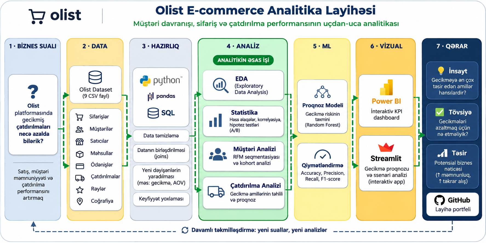
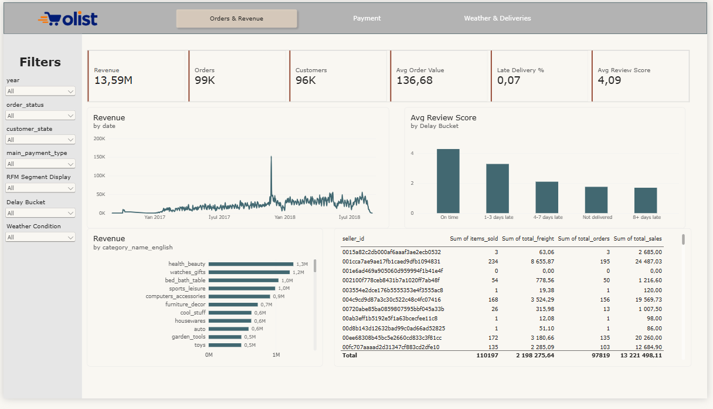
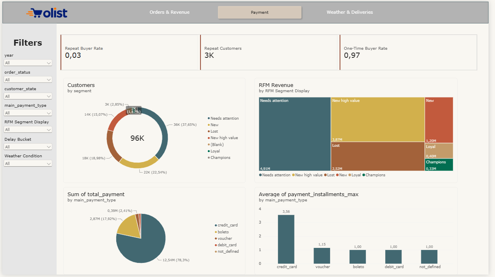
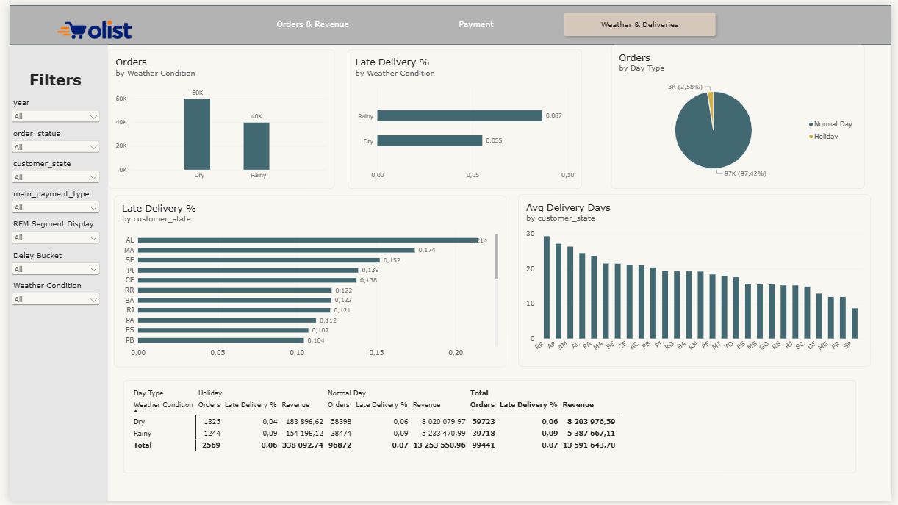

# Olist E-Commerce Analitikası

Braziliyanın Olist onlayn marketplace məlumatları əsasında hazırlanmış başdan-başa (end-to-end) e-commerce analitika layihəsi. Layihə **Python, Microsoft SQL Server, SQL, statistik analiz, Machine Learning və Streamlit** texnologiyalarını birləşdirərək xam marketplace məlumatlarını biznes insight-larına və çatdırılma gecikməsi riskini proqnozlaşdıran tətbiqə çevirir.

Analitik iş prosesi **Medallion arxitekturası (Bronze → Silver → Gold)** əsasında qurulub. Buraya məlumatların yüklənməsi, keyfiyyət yoxlamaları, təmizlənməsi, ölçü/fakt modelləşdirilməsi, biznes hesabatları, statistik hipotez testləri və proqnozlaşdırıcı modelləşdirmə daxildir.

---

## Mündəricat

- [Layihəyə ümumi baxış](#layihəyə-ümumi-baxış)
- [Biznes sualları](#biznes-sualları)
- [Texnologiyalar](#texnologiyalar)
- [Məlumat dəsti](#məlumat-dəsti)
- [Arxitektura](#arxitektura)
- [Repozitoriyanın strukturu](#repozitoriyanın-strukturu)
- [Əsas analizlər və nəticələr](#əsas-analizlər-və-nəticələr)
- [Machine Learning: gecikmiş çatdırılmanın proqnozlaşdırılması](#machine-learning-gecikmiş-çatdırılmanın-proqnozlaşdırılması)
- [Power BI dashboard](#power-bi-dashboard)
- [Streamlit tətbiqi](#streamlit-tətbiqi)
- [Layihənin işə salınması](#layihənin-işə-salınması)
- [Notebook-ların icra ardıcıllığı](#notebook-ların-icra-ardıcıllığı)
- [Konfiqurasiya ilə bağlı vacib qeydlər](#konfiqurasiya-ilə-bağlı-vacib-qeydlər)
- [Məhdudiyyətlər və növbəti addımlar](#məhdudiyyətlər-və-növbəti-addımlar)

---

## Layihəyə ümumi baxış

Olist Braziliyada müştəriləri və satıcıları bir araya gətirən e-commerce marketplace platformasıdır. Bu layihə sifarişlər, ödənişlər, məhsullar, satıcılar, müştəri rəyləri, çatdırılma göstəriciləri və hava şəraiti, rəsmi bayramlar, valyuta məzənnələri kimi əlavə kontekst məlumatları üzrə marketplace əməliyyatlarını təhlil edir.

Layihənin məqsədi analitikanın tam iş axınını nümayiş etdirməkdir:

1. Raw CSV fayllarını və xarici API məlumatlarını SQL Server-ə yükləmək.
2. Mənbə məlumatlarını yoxlamaq və təmizləmək.
3. Məlumatları Bronze, Silver və Gold qatlarına ayırmaq.
4. Analitik cədvəllər və SQL hesabatları hazırlamaq.
5. Təsviri və inferensial statistika vasitəsilə biznes suallarını araşdırmaq.
6. Çatdırılma gecikməsi riskini qiymətləndirmək üçün Machine Learning modeli öyrətmək.
7. Modelin proqnozlarını Streamlit tətbiqi vasitəsilə təqdim etmək.

## Biznes sualları

Analiz çərçivəsində aşağıdakı suallar araşdırılır:

- Çatdırılma performansı necə dəyişir və sifarişlərin hansı hissəsi gecikir?
- Gecikmiş çatdırılma daha aşağı müştəri rəyləri ilə əlaqəlidirmi?
- Gecikmə müddəti artdıqca müştəri məmnuniyyəti azalırmı?
- Hansı satıcılar daha çox satış edir və onların çatdırılma xərcləri necə fərqlənir?
- Hansı məhsul kateqoriyaları yüksək gəlirlə yanaşı yaxşı müştəri rəylərinə də malikdir?
- San-Pauluda gündəlik sifariş sayı yağıntı ilə əlaqəlidirmi?
- Rəsmi bayram günlərində gündəlik sifariş və satış həcmi dəyişirmi?
- Sifariş yaradılan anda məlum olan göstəricilər əsasında gecikmə riskini proqnozlaşdırmaq mümkündürmü?

## Texnologiyalar

| İstiqamət | İstifadə olunan alətlər |
|---|---|
| Proqramlaşdırma | Python |
| Məlumatların emalı | pandas, NumPy |
| Verilənlər bazası | Microsoft SQL Server 2022 |
| SQL bağlantısı | SQLAlchemy, pyodbc / pymssql |
| Analiz və statistika | SciPy, Jupyter Notebook |
| Machine Learning | scikit-learn, Random Forest |
| Modelin saxlanması | joblib |
| İnteraktiv tətbiq | Streamlit |
| Konteynerləşdirmə | Docker Compose |
| Xarici məlumat mənbələri | Nager.Date, Frankfurter, Open-Meteo API-ləri |

---

## Məlumat dəsti

Layihədə açıq mənbəli **Brazilian E-Commerce Public Dataset by Olist** məlumat dəstindən istifadə olunur. Mənbə CSV faylları repozitoriyanın `data/olist_dataset/` qovluğunda yerləşir.

Əsas məlumat dəsti təxminən **2016–2018-ci illər** üzrə marketplace əməliyyatlarını əhatə edir və aşağıdakı fayllardan ibarətdir:

| Mənbə faylı | Təsviri |
|---|---|
| `olist_customers_dataset.csv` | Müştəri ID-ləri, yerləşmə məlumatları və poçt indeksləri |
| `olist_geolocation_dataset.csv` | Coğrafi koordinatlar və yerləşmə atributları |
| `olist_orders_dataset.csv` | Sifariş statusu, alış, təsdiq və çatdırılma tarixləri |
| `olist_order_items_dataset.csv` | Məhsullar, satıcılar, məhsul qiymətləri, çatdırılma xərcləri və göndəriş limitləri |
| `olist_order_payments_dataset.csv` | Ödəniş üsulları, taksit sayı və ödəniş məbləğləri |
| `olist_order_reviews_dataset.csv` | Müştəri rəylərinin balları və şərhləri |
| `olist_products_dataset.csv` | Məhsul kateqoriyaları, ölçülər, çəki və digər təsviri atributlar |
| `olist_sellers_dataset.csv` | Satıcı ID-ləri və yerləşmə məlumatları |
| `product_category_name_translation.csv` | Məhsul kateqoriyalarının portuqal dilindən ingilis dilinə tərcüməsi |

### Xarici məlumat mənbələri

Analitik modelə üç əlavə məlumat mənbəyi inteqrasiya olunub:

- **Nager.Date:** 2016–2018-ci illər üzrə Braziliyanın rəsmi bayram günləri.
- **Frankfurter:** Analiz dövrü üçün BRL-dən USD-yə valyuta məzənnələri.
- **Open-Meteo:** San-Paulu üzrə gündəlik maksimum/minimum temperatur və yağıntı göstəriciləri.

API cavabları lokal olaraq `data/api/` qovluğunda saxlanılır və Bronze qatına yüklənir. API-lərdən məlumatların əldə edilməsi üçün kod da müvafiq notebook-larda mövcuddur.

---

## Arxitektura

Layihədə SQL Server üzərində Medallion arxitekturasından istifadə olunur.




### Bronze qatı

Bronze qatı mənbə məlumatlarını minimal transformasiya ilə saxlayır. CSV faylları SQL Server-ə yüklənir, API məlumatları isə əldə edilərək JSON fayllarında və verilənlər bazası cədvəllərində saxlanılır.

### Silver qatı

Silver qatı təmizlənmiş və uyğun data type-lara çevrilmiş məlumatları ehtiva edir. Əsas transformasiyalar:

- Tarix, ədədi və identifikator sütunlarının uyğun data type-lara çevrilməsi.
- Mətn dəyərlərinin standartlaşdırılması və boş dəyərlərin emalı.
- Təkrarlanan qeydlərin uyğun qaydada silinməsi və ya həll edilməsi.
- Məhsul kateqoriyalarının tərcümə edilməsi.
- Məhsul, satıcı, müştəri, sifariş, ödəniş, rəy və geolokasiya məlumatlarının təmizlənməsi.
- Hava şəraiti, bayram günləri və valyuta məzənnələri üzrə referens məlumatların hazırlanması.

### Gold qatı

Gold qatı biznes analizinə hazır dimension, fact cədvəllərini və analitik mart-ları özündə birləşdirir.

Əsas obyektlər:

| Obyekt | Təyinatı |
|---|---|
| `gold.dim_customers` | Müştəri atributları və unikal müştəri identifikatorları |
| `gold.dim_geography` | Poçt indeksi səviyyəsində coğrafi atributlar |
| `gold.dim_products` | Məhsul atributları və tərcümə edilmiş kateqoriyalar |
| `gold.dim_sellers` | Satıcı atributları |
| `gold.dim_date` | Təqvim, bayram, valyuta məzənnəsi və hava şəraiti məlumatları |
| `gold.fact_orders` | Sifariş səviyyəsində çatdırılma və ödəniş göstəriciləri |
| `gold.fact_order_items` | Sifariş elementləri üzrə satış və çatdırılma xərcləri |
| `gold.fact_reviews` | Müştəri rəyləri haqqında məlumatlar |
| `gold.mart_customer_rfm` | Recency, Frequency, Monetary dəyərləri və müştəri seqmentləri |
| `gold.mart_seller_performance` | Satıcıların satış, sifariş, məhsul və çatdırılma xərcləri üzrə performansı |
| `gold.mart_daily_sales_weather` | Hava və bayram məlumatları ilə zənginləşdirilmiş gündəlik satış və sifariş göstəriciləri |

Hesabat notebook-u konkret biznes suallarına cavab vermək üçün əlavə `gold.report_*` cədvəlləri də yaradır.

---

## Əsas analizlər və nəticələr

Aşağıdakı nəticələr repozitoriyaya daxil edilmiş və icra olunmuş notebook-lardan götürülüb. Bu nəticələr mövcud tarixi məlumatlarda müşahidə olunan əlaqələri göstərir; onları avtomatik olaraq səbəb-nəticə əlaqəsi kimi şərh etmək olmaz.

### 1. Çatdırılma performansı və müştəri məmnuniyyəti

Statistik analiz vaxtında çatdırılmış sifarişlərin rəy ballarını təxmini çatdırılma tarixindən sonra çatdırılmış sifarişlərlə müqayisə edir.

| Göstərici | Vaxtında çatdırılan sifarişlər | Gecikmiş sifarişlər |
|---|---:|---:|
| Sifariş sayı | 89,443 | 6,381 |
| Analiz edilən sifarişlərdə payı | 93.3% | 6.7% |
| Orta rəy balı | 4.29 | 2.27 |
| 1–2 bal verilmiş rəylərin payı | 9.2% | 62.4% |

Gecikmiş sifarişlər üzrə orta rəy balı **2.02 bal daha aşağıdır**. Mann–Whitney U testi p-dəyərinin 0.001-dən aşağı olduğunu göstərir; bu, rəy ballarının paylanmaları arasındakı fərqin statistik baxımdan əhəmiyyətli olduğunu bildirir.

Analiz həmçinin gecikmə müddəti uzandıqca narazılığın artdığını göstərir:

| Çatdırılma nəticəsi | 1–2 bal verilmiş rəylərin payı |
|---|---:|
| Vaxtında | 9.28% |
| 1–3 gün gecikmə | 32.17% |
| 4–7 gün gecikmə | 67.65% |
| 8+ gün gecikmə | 79.19% |

**Biznes nəticəsi:** Çatdırılmanın vaxtında həyata keçirilməsi müştəri təcrübəsi ilə sıx əlaqəlidir. Təxmini çatdırılma tarixini keçmək riski olan sifarişlərə əvvəlcədən diqqət yetirmək faydalı ola bilər.

### 2. Korrelyasiya analizi

Rəy balları ordinal xarakter daşıdığına və bir neçə ədədi dəyişənin paylanması simmetrik olmadığına görə Spearman rank korrelyasiyasından istifadə edilib.

| Əlaqə | Nümunə sayı | Spearman ρ | Şərh |
|---|---:|---:|---|
| Çatdırılma günləri və rəy balı | 95,830 | -0.235 | Zəif mənfi əlaqə |
| Gecikmə günləri və rəy balı | 95,830 | -0.176 | Zəif mənfi əlaqə |
| Məhsul qiyməti və çatdırılma xərci | 110,196 | 0.434 | Orta müsbət əlaqə |

Ümumi çatdırılma müddəti ilə rəy balı arasındakı korrelyasiya nisbətən zəifdir. Bununla belə, gecikmə intervalları üzrə müqayisə göstərir ki, sifarişin vəd edilmiş tarixdən sonra çatdırılması rəy ballarında nəzərəçarpan azalma ilə müşayiət olunur. Bu, tək bir korrelyasiya əmsalının biznesdəki bütün nümunələri həmişə əks etdirmədiyini göstərir.

### 3. Satıcı performansı

Satıcı hesabatında satışlar, sifariş sayı, sifariş başına orta satış, çatdırılma xərcləri və çatdırılma xərclərinin satışlara nisbəti müqayisə olunur.

SQL hesabatından seçilmiş nəticələr:

- Ən yüksək satış həcminə malik satıcının məhsul satışları təxminən **226,987.93** təşkil edib.
- Ən çox sifariş qəbul edən satıcı **1,819 sifariş** emal edib, lakin sifariş başına orta satış təxminən **66.36** olub.
- Yüksək sifariş həcminə malik satıcılar arasında çatdırılma xərclərinin satışlara nisbəti təxminən **3.61%-dən 47.12%-dək** dəyişib.
- Orta satış müqayisəsində minimum 100 sifariş şərtinin tətbiqi çox az sayda sifarişi olan satıcıların reytinqi təhrif etməsinin qarşısını almağa kömək edir.

**Biznes nəticəsi:** Satıcıların performansı yalnız satış məbləği və ya sifariş sayı ilə deyil, bir neçə göstərici və minimum həcm şərti əsasında qiymətləndirilməlidir. Çatdırılma xərclərinin satışlara nisbəti əməliyyat müqayisəsi üçün faydalıdır, lakin mənfəət marjası hesab edilmir.

### 4. Məhsul kateqoriyalarının performansı

Kateqoriyalar üzrə analiz gəliri, satılmış məhsul sayını, orta məhsul qiymətini və müştəri rəy ballarını müqayisə edir.

| Kateqoriya | Məhsul satış gəliri | Satılmış məhsul sayı | Orta məhsul qiyməti |
|---|---:|---:|---:|
| Health & beauty | 1,258,681.34 | 9,670 | 130.16 |
| Watches & gifts | 1,205,005.68 | 5,991 | 201.14 |
| Bed, bath & table | 1,036,988.68 | 11,115 | 93.30 |
| Sports & leisure | 988,048.97 | 8,641 | 114.34 |
| Computers & accessories | 911,954.32 | 7,827 | 116.51 |

Əlavə müşahidələr:

- Analizdə ən yüksək məhsul satış gəliri Health & beauty kateqoriyasında qeydə alınıb.
- Bed, bath & table bu aparıcı kateqoriyalar arasında ən çox məhsul satılan kateqoriya olub, lakin orta rəy balı nisbətən aşağıdır (təxminən 3.97).
- Watches & gifts aparıcı gəlir kateqoriyaları arasında ən yüksək orta məhsul qiymətinə malikdir.
- Minimum rəy sayı şərti tətbiq edilən kateqoriya analizində Books & general interest kateqoriyasının orta rəy balı təxminən 4.46 olub.

**Biznes nəticəsi:** Ən çox gəlir gətirən kateqoriyalar müştəri məmnuniyyəti baxımından həmişə lider olmur. Kateqoriyalar üzrə qərarlar satış həcmi, orta qiymət və müştəri rəyləri birlikdə nəzərə alınmaqla verilməlidir.

### 5. San-Pauluda hava şəraiti və sifariş aktivliyi

SQL hesabatında yağışlı günlərdə orta gündəlik sifariş sayının daha yüksək olduğu müşahidə edilib. **Vacib əhatə dairəsi qeydi:** hava məlumatları San-Paulu şəhərini əhatə edir, lakin gündəlik satış martı bütün dataset üzrə çatdırılmış sifarişləri birləşdirir; sifarişlər San-Paulu müştəriləri və ya satıcıları ilə məhdudlaşdırılmır. Buna görə müqayisə San-Paulu hava şəraiti ilə ümummilli marketplace aktivliyini əlaqələndirir və yalnız ilkin, kəşfiyyat xarakterli analiz kimi qiymətləndirilməlidir:

| Hava şəraiti | Gün sayı | Orta gündəlik sifariş | Orta gündəlik satış |
|---|---:|---:|---:|
| Yağışsız | 414 | 81.77 | 11,341.67 |
| Yağışlı | 682 | 91.83 | 12,501.53 |

Lakin sonrakı statistik analiz fərqin **statistik baxımdan əhəmiyyətli olmadığını** göstərib (Mann–Whitney p-dəyəri təxminən 0.30).

Notebook-larda dövrlər üzrə mühüm fərq müəyyən edilib: 2016-cı ildə sifariş aktivliyi çox aşağı olub, yağışlı günlərin payı və sifariş həcmi isə illər üzrə fərqlənib. Müqayisə 2017–2018-ci illərlə məhdudlaşdırıldıqda yağışsız günlərdə orta sifariş sayı 135.45, yağışlı günlərdə isə 129.91 olub; bu fərq də statistik baxımdan əhəmiyyətli deyil (p-dəyəri təxminən 0.17).

**Nəticə:** Mövcud analiz yağışın gündəlik sifariş sayını dəyişdirdiyini təsdiqləmək üçün kifayət qədər statistik sübut təqdim etmir. İlkin orta göstəricilər arasındakı fərq zaman trendinin təsiri ilə qarışmışdı.

Ayrı SQL müqayisəsində yağışlı günlər üçün gecikmiş çatdırılma faizi **8.14%**, yağışsız günlər üçün isə **4.24%** olub. Bu göstərici eyni San-Paulu hava məlumatlarının marketplace üzrə çatdırılmış sifarişlərlə birləşdirilməsi əsasında hesablanıb. Bu, müşahidə olunan əlaqədir; San-Pauluda yağan yağışın ölkə üzrə çatdırılma gecikmələrinə səbəb olduğunu sübut etmir.

### 6. Rəsmi bayramlar və satışlar

Gündəlik satış analizi milli bayram günlərini digər günlərlə müqayisə edir:

| Gün tipi | Gün sayı | Orta gündəlik sifariş | Orta gündəlik satış |
|---|---:|---:|---:|
| Adi günlər | 1,057 | 88.92 | 12,197.51 |
| Bayram günləri | 39 | 63.72 | 8,429.09 |

Təhlil olunan dövrdə bayram günlərində orta gündəlik sifariş sayı təxminən 28%, orta gündəlik satış isə təxminən 31% aşağı olub.

Notebook-da bayramdan əvvəlki və sonrakı günlər də müqayisə edilir. Nəticələr bayram günü və ondan əvvəlki gün aktivliyin daha aşağı olduğunu, növbəti gün isə qismən bərpa baş verdiyini göstərir.

**Biznes nəticəsi:** Tarixi bayram tendensiyaları kampaniyaların, işçi heyətinin və sifarişlərin icrası üzrə resurs planlamasında faydalı ola bilər. Bayram günləri üzrə nümunə sayı nisbətən az olduğundan bu tendensiya əlavə dövrlərdə də yoxlanılmalıdır.

---

## Machine Learning: gecikmiş çatdırılmanın proqnozlaşdırılması

Layihədə sifarişin təxmini çatdırılma tarixindən sonra çatdırılıb-çatdırılmayacağını qiymətləndirən Random Forest classifier modeli hazırlanıb.

### Məqsəd

Məqsəd sifariş yaradılan anda mövcud olan məlumatlardan istifadə etməklə gecikmə riskini proqnozlaşdırmaqdır. Data leakage riskinin qarşısını almaq üçün faktiki çatdırılma tarixi və müştəri rəy balı kimi çatdırılmadan sonra məlum olan göstəricilər modelin feature-larına daxil edilməyib.

### Model üçün istifadə olunan məlumatlar

- Faktiki çatdırılma tarixi məlum olan **96,470** çatdırılmış sifariş.
- **9 giriş feature-i**.
- **89,936** vaxtında çatdırılmış sifariş.
- **6,534** gecikmiş sifariş (təxminən 6.8%).

### Feature-lar

| Feature | Təsviri |
|---|---|
| `purchase_month` | Sifarişin verildiyi ay |
| `purchase_weekday` | Sifarişin verildiyi həftə günü |
| `estimated_days` | Vəd edilmiş çatdırılma müddəti |
| `item_count` | Sifarişdəki məhsulların sayı |
| `total_price` | Məhsul qiymətlərinin cəmi |
| `total_freight` | Çatdırılma xərclərinin cəmi |
| `total_weight` | Məhsulların ümumi çəkisi |
| `total_volume` | Məhsulların ümumi həcmi |
| `same_state` | Müştəri və satıcının eyni ştatda olub-olmaması |

Çəki və həcm üzrə çatışmayan dəyərlər medianla doldurulur. Məlumatlar stratified split istifadə edilməklə 80/20 nisbətində train və test hissələrinə bölünür.

### Model

`RandomForestClassifier` aşağıdakı parametrlərlə öyrədilib:

- `n_estimators=100`
- `max_depth=10`
- `class_weight="balanced"`
- `random_state=42`

Gecikmiş sifarişlər azlıq sinfi olduğu üçün `class_weight="balanced"` parametrindən istifadə edilir.

### Test nəticələri

| Göstərici | Nəticə |
|---|---:|
| Accuracy | 0.76 |
| Gecikmiş çatdırılma üzrə precision | 0.16 |
| Gecikmiş çatdırılma üzrə recall | 0.59 |

Model test dəstində gecikmiş sifarişlərin təxminən 59%-ni müəyyən edir, lakin gecikmə kimi proqnozlaşdırılan sifarişlərin yalnız 16%-i həqiqətən gecikir. Başqa sözlə, model gecikmələrin nəzərəçarpan hissəsini aşkar edir, eyni zamanda çox sayda false positive yaradır.

Notebook-da qeyd edilmiş confusion matrix:

| | Vaxtında proqnozlaşdırılıb | Gecikmiş proqnozlaşdırılıb |
|---|---:|---:|
| Faktiki vaxtında | 13,900 | 4,087 |
| Faktiki gecikmiş | 540 | 767 |

Modelin nəticələrinə əsasən ən təsirli feature-lar arasında sifariş ayı, təxmini çatdırılma müddəti və çatdırılma xərci var.

**Şərh:** Bu model istehsalat mühitində istifadəyə tam hazır çatdırılma zəmanəti deyil, ilkin risk qiymətləndirmə alətidir. Operativ qərarlarda istifadə etməzdən əvvəl modelin ehtimalları ayrıca qiymətləndirilməli və kalibrasiya edilməlidir.

---

## Power BI dashboard

Layihəyə marketplace satışlarını, müştəri davranışını, ödənişləri, çatdırılmanı və hava şəraiti ilə əlaqəli göstəriciləri bir araya gətirən üç səhifəli Power BI dashboard daxildir. Hesabat səhifələrində il, sifariş statusu, müştəri ştatı, ödəniş növü, RFM seqmenti, gecikmə intervalı və hava şəraiti üzrə ümumi slicer-lər mövcuddur. Bu filtrlər istifadəçiyə biznesin müxtəlif istiqamətlərini araşdırmağa imkan verir.

### 1. Sifarişlər və gəlir (Orders & Revenue)


Bu səhifə marketplace performansına ümumi baxış təqdim edir:

- **Gəlir:** 13.59M
- **Sifarişlər:** 99K
- **Müştərilər:** 96K
- **Orta sifariş dəyəri:** 136.68
- **Gecikmiş çatdırılma faizi:** 7%
- **Orta müştəri rəy balı:** 4.09

Vizualizasiyalara zaman üzrə gəlir dinamikası, gecikmə intervalına görə orta rəy balı, məhsul kateqoriyası üzrə gəlir və satılan məhsul sayı, çatdırılma xərci, sifariş sayı və satış məbləğini göstərən satıcı performansı cədvəli daxildir.

### 2. Ödəniş analizi (Payment Analysis)



Bu səhifə müştərilərin alış davranışına və ödəniş üsullarına fokuslanır:

- Təkrar alış edən müştərilərin faizi və sayı.
- Yalnız bir dəfə alış edən müştərilərin faizi.
- Müştərilərin RFM seqmentləri üzrə bölgüsü.
- RFM seqmentləri üzrə gəlir payı.
- Ödəniş növləri üzrə ümumi ödəniş məbləği.
- Ödəniş növləri üzrə orta taksit sayı.

Ekran görüntüsündəki ümumi göstəricilər müştərilərin böyük əksəriyyətinin yalnız bir dəfə alış etdiyini göstərir. Bu səbəbdən müştəri saxlama (retention) və təkrar alış davranışı əlavə diqqət tələb edən istiqamətlərdir. Göstərilən görünüşdə ödəniş məbləğinin ən böyük hissəsi kredit kartlarının payına düşür.

### 3. Hava şəraiti və çatdırılma (Weather & Deliveries)



Bu səhifə hava şəraiti, müştəri ştatları və gün tipi üzrə çatdırılma performansını araşdırır:

- Yağışlı və yağışsız hava şəraitində sifariş sayı.
- Hava şəraitinə görə gecikmiş çatdırılma faizi.
- Adi günlər və bayram günləri üzrə sifariş bölgüsü.
- Müştərinin yaşadığı ştata görə gecikmiş çatdırılma faizi.
- Müştərinin yaşadığı ştata görə orta çatdırılma müddəti.
- Hava şəraiti və gün tipi üzrə sifariş sayı, gecikmə faizi və gəlirin detallı müqayisəsi.

Ekran görüntüsündə yağışlı günlərdə gecikmiş çatdırılma faizi yağışsız günlərə nisbətən daha yüksəkdir. Bu, təsviri müqayisədir və yağışın gecikmələrə səbəb olduğunu sübut etmir; coğrafiya, mövsümilik və digər əməliyyat amilləri də nəticəyə təsir göstərə bilər.

### Dashboard haqqında qeydlər

Ekran görüntülərindəki rəqəmlər çəkiliş zamanı aktiv olan filtr vəziyyətini əks etdirir. Digər dövrləri, ştatları, sifariş statuslarını, ödəniş üsullarını, müştəri seqmentlərini və gecikmə intervallarını araşdırmaq üçün hesabatdakı slicer-lərdən istifadə edin. Pul göstəriciləri hesabatda təqdim edildiyi formada göstərilib; onları digər mənbələrdəki rəqəmlərlə müqayisə etməzdən əvvəl modeldə istifadə olunan valyutanı yoxlayın.

---

## Streamlit tətbiqi

**Canlı demo:** [Olist – Gecikmiş çatdırılma riskinin proqnozlaşdırılması](https://olist-late-delivery-test.streamlit.app/)

Yerləşdirilmiş tətbiqdə sifariş atributlarını daxil edərək çatdırılmanın gecikmə ehtimalını yoxlaya bilərsiniz. Canlı tətbiq bu repozitoriyadakı mənbə kodunu və öyrədilmiş modeli tamamlayır.

Streamlit tətbiqinin kodu `app/main.py` faylında yerləşir. Tətbiq `models/late_delivery_rf.pkl` faylındakı öyrədilmiş modeli yükləyir və istifadəçiyə sifariş məlumatlarını daxil edərək gecikmə ehtimalını hesablamağa imkan verir.

Tətbiqdə aşağıdakı məlumatlar daxil edilir:

- Sifarişin verildiyi ay və həftənin günü.
- Təxmini çatdırılma müddəti.
- Sifarişdəki məhsulların sayı.
- Məhsulların ümumi qiyməti və çatdırılma xərci.
- Məhsulların ümumi çəkisi və həcmi.
- Müştəri və satıcının eyni ştatda olub-olmaması.

İstifadəçi məlumatları daxil edib sorğunu göndərdikdən sonra tətbiq aşağıdakı nəticələri göstərir:

- Gecikmiş çatdırılmanın təxmini ehtimalı.
- Ehtimalı vizual göstərən indikator.
- Sifarişin gecikmiş və ya vaxtında çatdırılacağına dair model proqnozu.

Tətbiqin interfeysi Azərbaycan dilindədir.

### Tətbiqi lokal olaraq işə salmaq

Layihənin əsas qovluğunda aşağıdakı əmrləri icra edin:

```bash
pip install -r app/requirements.txt
streamlit run app/main.py
```

Tətbiqin işləməsi üçün `models/late_delivery_rf.pkl` model faylı mövcud olmalıdır.

---

## Layihənin işə salınması

### İlkin tələblər

- Python 3.10 və ya uyğun versiya.
- Docker Desktop və ya Docker Engine.
- Microsoft SQL Server 2022 konteyneri.
- Jupyter Notebook və ya JupyterLab.
- SQL Server bağlantısı üçün uyğun driver:
  - Windows üçün ODBC Driver 18 for SQL Server; və ya
  - alternativ olaraq `pymssql`.

### 1. Repozitoriyanı klonlayın

```bash
git clone https://github.com/abasovmanaf-3267/olist-ecommerce-analytics.git
cd olist-ecommerce-analytics
```

### 2. Virtual environment yaradın və aktivləşdirin

```bash
python -m venv .venv
```

Windows:

```bash
.venv\Scripts\activate
```

macOS / Linux:

```bash
source .venv/bin/activate
```

### 3. Layihənin asılılıqlarını quraşdırın

```bash
pip install -r requirements.txt
```

### 4. SQL Server bağlantı məlumatlarını konfiqurasiya edin

Verilənlər bazasını işə salmazdan əvvəl `docker-compose.yml` və `notebooks/db.py` fayllarını yoxlayın.

Mövcud layihə fayllarında lokal inkişaf mühiti üçün istifadə edilmiş bağlantı məlumatları və uyğunlaşdırılmalı verilənlər bazası adı konfiqurasiyası var. Pipeline-ı işə salmazdan əvvəl inkişaf mühiti üçün olan məlumatları öz lokal parametrlərinizlə əvəz edin, parolları source control-a əlavə etməyin və `notebooks/db.py` faylında istifadə edilən verilənlər bazası adının setup SQL skriptində yaradılan adla eyni olmasını təmin edin.

Real bağlantı məlumatlarını repozitoriyada paylaşmayın.

### 5. SQL Server-i başladın

```bash
docker compose up -d
```

Notebook-ları icra etməzdən əvvəl SQL Server konteynerinin sağlam (healthy) vəziyyətə gəlməsini gözləyin.

### 6. Verilənlər bazasını hazırlayın və məlumatları yükləyin

Notebook-ları aşağıdakı ardıcıllıqla icra edin:

1. `notebooks/01_bronze/01_bronze_load.ipynb`
2. `notebooks/02_silver/02_silver_a.ipynb`
3. `notebooks/02_silver/02_silver_b.ipynb`
4. `notebooks/03_gold/03_gold_sql_report/03_sql_report.ipynb`
5. `notebooks/03_gold/03_gold_sql_report/03_sql_analysis_b.ipynb`
6. `notebooks/03_gold/03_gold_analysis/03_gold_a_correlations.ipynb`
7. `notebooks/03_gold/03_gold_analysis/03_gold_analysis_b.ipynb`
8. `notebooks/03_gold/04_gold_ml/machine_learning.ipynb`

Bronze notebook-u mənbə CSV fayllarını yükləyir və əlavə API məlumatlarını əldə edir. Silver notebook-ları datanı təmizləyir və standartlaşdırır. Gold notebook-ları hesabat cədvəlləri yaradır, analizləri icra edir və Machine Learning modelini öyrədir.

Bəzi notebook-lar əvvəlki mərhələlərdə yaradılmış cədvəllərdən asılıdır. Buna görə icra ardıcıllığına riayət etmək vacibdir.

### 7. Streamlit tətbiqini başladın

Model faylı hazır olduqdan sonra:

```bash
pip install -r app/requirements.txt
streamlit run app/main.py
```

---

## Konfiqurasiya ilə bağlı vacib qeydlər

Layihəni yeni mühitdə istifadə etməzdən əvvəl aşağıdakı texniki məqamları nəzərdən keçirin:

- **Verilənlər bazasının adı:** `notebooks/db.py` faylında verilənlər bazasının adı hazırda `Datacube` kimi təyin edilib, `sql/01_setup_database.sql` skripti isə `OlistEcommerce` yaradır. Pipeline-ı işə salmazdan əvvəl bu adları uyğunlaşdırın.
- **Giriş məlumatları:** SQL Server üçün lokal istifadəçi adı və parol hazırda `docker-compose.yml` və `notebooks/db.py` fayllarında birbaşa qeyd edilib. Repozitoriyanı paylaşmazdan və ya tətbiqi deploy etməzdən əvvəl bunları environment variable-lara köçürün.
- **Model mühiti:** Model serialize edilmiş scikit-learn obyekti kimi saxlanılır. Pickle faylını yükləyərkən uyğun scikit-learn versiyasından istifadə edin; ideal olaraq təlim mühitinin dəqiq versiyalarını dependency lock faylında qeyd edin.
- **Xarici API-lər:** Bronze notebook-u xarici API-lərə sorğular göndərir. Mənbə məlumatlarını yeniləmək üçün internet bağlantısı lazımdır. Keşlənmiş JSON faylları `data/api/` qovluğunda mövcuddur.
- **Hava məlumatlarının əhatə dairəsi:** Hava müşahidələri San-Paulu üçündür, gündəlik satış martı isə marketplace üzrə çatdırılmış sifarişləri birləşdirir. Buna görə hava müqayisələri yalnız San-Paulu müştəriləri və ya satıcıları üzrə analiz deyil.
- **Valyuta:** Layihə BRL-dən USD-yə valyuta məzənnələrini əldə edir və tarix dimension-unu bu məlumatlarla zənginləşdirir. Fərqli mənbələrdən olan maliyyə göstəricilərini müqayisə etməzdən əvvəl hər hesabatda hansı valyutadan istifadə olunduğunu yoxlayın.

---

## Məhdudiyyətlər və növbəti addımlar

Layihəni daha da inkişaf etdirmək üçün mümkün istiqamətlər:

1. **ML precision göstəricisini yaxşılaşdırmaq:** Classification threshold-u optimallaşdırmaq, fərqli modelləri müqayisə etmək, accuracy ilə yanaşı precision-recall curve və PR-AUC göstəricilərindən istifadə etmək.
2. **Proqnoz ehtimallarını kalibrasiya etmək:** Ehtimalların kalibrasiyasını qiymətləndirmək və onları operativ risk göstəricisi kimi təqdim etməzdən əvvəl kalibrasiya tətbiq etmək.
3. **Validasiyanı gücləndirmək:** Modelin gələcək sifarişlər üzrə performansını daha real qiymətləndirmək üçün time-based validation tətbiq etmək.
4. **Feature engineering-i təkmilləşdirmək:** Proqnoz anında mövcud olması şərti ilə marşrut məsafəsi, satıcının əvvəlki çatdırılma performansı, məhsul kateqoriyası və mövsümi tələb kimi feature-ları araşdırmaq.
5. **Statistik nəzarətləri artırmaq:** Hava şəraiti və bayram analizlərində il/ay faktorlarını nəzərə almaq və uyğun regression modellərindən istifadə etmək.
6. **Konfiqurasiyanı təhlükəsizləşdirmək:** Giriş məlumatlarını environment variable-lara köçürmək, database setup skriptlərini uyğunlaşdırmaq və dependency versiyalarını sabitləmək.
7. **Avtomatlaşdırılmış testlər əlavə etmək:** Sətir sayını, unikallığı, boş dəyərləri, join-ləri və Gold qatının biznes qaydalarını yoxlamaq.
8. **Dashboard sənədləşməsini genişləndirmək:** Hazırda üç Power BI səhifəsi yuxarıda ekran görüntüləri ilə təsvir edilib; hesabatın dizaynı və ya KPI tərifləri dəyişdikdə görüntüləri yeniləmək.

---

